<div align="center">

<!-- ========================================== -->
<!-- 1. DYNAMIC ANIMATED HEADER (WAVING GRADIENT) -->
<!-- ========================================== -->


<!-- ========================================== -->
<!-- TYPING SVG SUBHEADER -->
<!-- ========================================== -->
<a href="https://github.com/tkamleair1-pixel">
  
</a>

<p align="center">
  <a href="https://linkedin.com/in/tiyasa-kamle-b68b9a397/">
    
  </a>
  <a href="https://github.com/tkamleair1-pixel">
    
  </a>
  <a href="mailto:tkamleair1@gmail.com">
    
  </a>
  
  
</p>

</div>

---

<!-- ========================================== -->
<!-- 2. HERO / PROFILE MATRIX (AVATAR + BIO)   -->
<!-- ========================================== -->

<table>
  <tr>
    <td width="330" valign="top" align="center">
      <!-- 
        LINE-BY-LINE RASTER SCANLINE REVEAL AVATAR 
        Rendered via assets/animated-avatar.svg 
      -->
      <a href="https://github.com/tkamleair1-pixel">
        
      </a>
    </td>
    <td valign="top">
      <h3>⚡ System Architect & AI Engineer</h3>
      <p>
        I am a <b>2nd Year B.Tech Computer Science & Engineering</b> undergraduate at the 
        <b>Academy of Technology (AOT)</b>, West Bengal <i>(affiliated with MAKAUT)</i>.
      </p>
      <p>
        My core obsession lies at the intersection of <b>on-premise agentic AI</b>, <b>edge computer vision</b>, 
        and <b>privacy-preserving autonomous architectures</b>. I engineer self-hosted, air-gapped intelligent agents 
        that run on open-weight models—ensuring zero data leakage while delivering deterministic tool-calling, 
        vector reasoning, and high-fidelity user experiences.
      </p>
      <ul>
        <li>🔭 <b>Currently Architecting:</b> Sovereign on-premise agent workbenches powered by local LLMs & air-gapped RAG pipelines.</li>
        <li>🔬 <b>Research & Exploration:</b> On-device computer vision perception for browser agents & real-time traffic signal RL.</li>
        <li>💡 <b>Philosophy:</b> True intelligence should be private, inspectable, and beautiful to interact with.</li>
        <li>📫 <b>Direct Transmit:</b> <a href="mailto:tkamleair1@gmail.com">tkamleair1@gmail.com</a></li>
      </ul>
      <p>
        <a href="https://www.linkedin.com/in/tiyasa-kamle-b68b9a397/">
          
        </a>
        <a href="mailto:tkamleair1@gmail.com">
          
        </a>
      </p>
    </td>
  </tr>
</table>

---

<!-- ========================================== -->
<!-- 3. CORE PILLARS & ARCHITECTURAL FOCUS     -->
<!-- ========================================== -->

### ⚙️ Core Architectural Pillars

```yaml
01_SOVEREIGN_AI:
  Focus: "Air-gapped Agentic Systems, Open-Weight Orchestration, Local Tool Execution"
  Motto: "Private by default, zero cloud telemetry, deterministic reasoning."
02_EDGE_PERCEPTION:
  Focus: "Real-time YOLO pipelines, Spatial Telemetry, Reinforcement Learning with SUMO"
  Motto: "Low-latency perception on edge hardware."
03_INTELLIGENT_UX:
  Focus: "FastAPI backends, ChromaDB semantic retrieval, visionOS Glassmorphic interfaces"
  Motto: "Complex systems distilled into fluid, tactile human interfaces."
```

---

<!-- ========================================== -->
<!-- 4. TECH STACK & SYSTEM MATRIX             -->
<!-- ========================================== -->

### 🛠️ Tech Stack & Tooling

<div align="left">

**Core Languages**  


<br/>

**AI, Vision & Systems**  


<br/>

**Frontend, DevOps & Tools**  


<br/>

**Design & Prototyping**  


</div>

---

<!-- ========================================== -->
<!-- 5. FEATURED ENGINEERING PROJECTS          -->
<!-- ========================================== -->

### 🚀 Featured Engineering Projects

<table>
  <tr>
    <td width="50%" valign="top">
      <h4>🛰️ 01. Sovereign On-Premise Agentic AI Workbench</h4>
      <p>
        
        
        
      </p>
      <ul>
        <li><b>Zero Data Leakage:</b> Air-gapped orchestration framework executing open-weight models completely locally.</li>
        <li><b>Deterministic Tooling:</b> Autonomous planning and safe code execution engine without third-party cloud APIs.</li>
        <li><b>Privacy-Guaranteed:</b> Engineered for sensitive environments requiring complete sovereignty over data & weights.</li>
      </ul>
      <p>
        <a href="https://github.com/tkamleair1-pixel">
          
        </a>
      </p>
    </td>
    <td width="50%" valign="top">
      <h4>🚦 02. SignalX — Adaptive Traffic Management System</h4>
      <p>
        
        
        
      </p>
      <ul>
        <li><b>Perception Layer:</b> Real-time vehicle detection and queue density estimation via custom YOLO computer vision pipelines.</li>
        <li><b>Dynamic Control:</b> Deep Q-Learning agent dynamically adjusting traffic cycle phases in a simulated SUMO micro-grid.</li>
        <li><b>Throughput Optimization:</b> Demonstrates up to 34% reduction in intersection idling times and congestion spikes.</li>
      </ul>
      <p>
        <a href="https://github.com/tkamleair1-pixel">
          
        </a>
      </p>
    </td>
  </tr>
  <tr>
    <td width="50%" valign="top">
      <h4>🤼 03. SPORTIFY / SPORTI-CORE</h4>
      <p>
        
        
        
      </p>
      <ul>
        <li><b>Athletic Operations:</b> End-to-end management platform engineered specifically for the Eastern Railway Kabaddi Team.</li>
        <li><b>Performance Telemetry:</b> Player fitness indices, fixture schedules, medical tracking, and match performance analytics.</li>
        <li><b>Production Ready:</b> Modular relational schema and low-latency API architecture handling sports administration.</li>
      </ul>
      <p>
        <a href="https://github.com/tkamleair1-pixel">
          
        </a>
      </p>
    </td>
    <td width="50%" valign="top">
      <h4>🎧 04. Muse — Spatial Music Discovery</h4>
      <p>
        
        
        
      </p>
      <ul>
        <li><b>Spatial Visual System:</b> Futuristic glassmorphic audio UI inspired by Apple Music and visionOS spatial design rules.</li>
        <li><b>Tactile Interactions:</b> Dynamic lighting refraction, multi-layered depth maps, and responsive sonic navigation cues.</li>
        <li><b>Design Architecture:</b> Complete high-fidelity design system and component token library crafted in Figma.</li>
      </ul>
      <p>
        <a href="https://github.com/tkamleair1-pixel">
          
        </a>
      </p>
    </td>
  </tr>
  <tr>
    <td width="50%" valign="top">
      <h4>👁️ 05. On-Device Visual Perception for Browser Agents</h4>
      <p>
        
        
        
      </p>
      <ul>
        <li><b>Edge Automation:</b> Solves DOM-free web navigation by empowering autonomous agents with lightweight visual perception.</li>
        <li><b>Constrained Compute:</b> Optimized for edge runtime environments where heavy multimodal server calls are infeasible.</li>
        <li><b>Problem Statement:</b> Formulated for the competitive ISRO Hackathon challenge track.</li>
      </ul>
      <p>
        <a href="https://github.com/tkamleair1-pixel">
          
        </a>
      </p>
    </td>
    <td width="50%" valign="top">
      <h4>🛡️ 06. ContractShield</h4>
      <p>
        
        
        
      </p>
      <ul>
        <li><b>Legal Risk Auditing:</b> Automated vector-search analysis platform identifying ambiguous terms and high-risk liabilities in legal agreements.</li>
        <li><b>Semantic Retrieval:</b> Powered by ChromaDB embeddings and localized context chunking for precise citation retrieval.</li>
        <li><b>Hackathon Project:</b> Built collaboratively with <i>Team Debug Divas</i> during the MLH Hacktropia Hackathon.</li>
      </ul>
      <p>
        <a href="https://github.com/tkamleair1-pixel">
          
        </a>
      </p>
    </td>
  </tr>
</table>

---

<!-- ========================================== -->
<!-- 6. HACKATHONS & RECOGNITIONS              -->
<!-- ========================================== -->

### 🏆 Hackathons & Accolades

```markdown
┌── [ HONORS & HACKATHON RECORD ] ────────────────────────────────────────────────────────┐
│                                                                                         │
│  🏅 MLH Hacktropia Hackathon                                                            │
│     Built "ContractShield" with Team Debug Divas — Legal Risk Vector Intelligence       │
│                                                                                         │
│  🚀 Techsprint — Google Developer Group (GDG-AOT)                                      │
│     Selected among Top 10 Teams for innovative prototype execution                      │
│                                                                                         │
│  🛰️ ISRO Hackathon                                                                      │
│     Engineered On-Device Visual Perception for Lightweight Autonomous Browser Agents   │
│                                                                                         │
│  🌟 Build Club AOT & Analects AOT Award                                                 │
│     Recognized for technical excellence, creative leadership, and community impact      │
│                                                                                         │
└─────────────────────────────────────────────────────────────────────────────────────────┘
```

---

<!-- ========================================== -->
<!-- 7. GITHUB METRICS & TELEMETRY              -->
<!-- ========================================== -->

### 📊 Telemetry & System Activity

<div align="center">

<table border="0">
  <tr>
    <td valign="middle" align="center">
      
    </td>
    <td valign="middle" align="center">
      
    </td>
  </tr>
</table>

<p align="center">
  
</p>

</div>

---

<!-- ========================================== -->
<!-- 8. AUTOMATED CONTRIBUTION GRAPH (SNAKE)    -->
<!-- ========================================== -->

### 🐍 Neural Contribution Stream

<div align="center">

<picture>
  <source media="(prefers-color-scheme: dark)" srcset="https://raw.githubusercontent.com/tkamleair1-pixel/tkamleair1-pixel/output/github-contribution-grid-snake-dark.svg">
  <source media="(prefers-color-scheme: light)" srcset="https://raw.githubusercontent.com/tkamleair1-pixel/tkamleair1-pixel/output/github-contribution-grid-snake.svg">
  
</picture>

</div>

---

<!-- ========================================== -->
<!-- 9. FOOTER & DISPATCH                      -->
<!-- ========================================== -->

<div align="center">

  <p><b>Interested in collaborating on Autonomous Agents, Edge AI, or Spatial UI?</b></p>
  
  <p>
    <a href="https://linkedin.com/in/tiyasa-kamle-b68b9a397/">
      
    </a>
    &nbsp;
    <a href="mailto:tkamleair1@gmail.com">
      
    </a>
    &nbsp;
    <a href="https://github.com/tkamleair1-pixel">
      
    </a>
  </p>

  

  <sub>Crafted with code, high-density SVG keyframes, and sovereign AI principles • © 2026 Tiyasa Kamle</sub>

</div>
